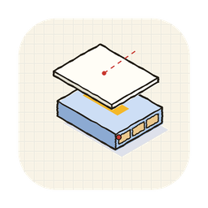
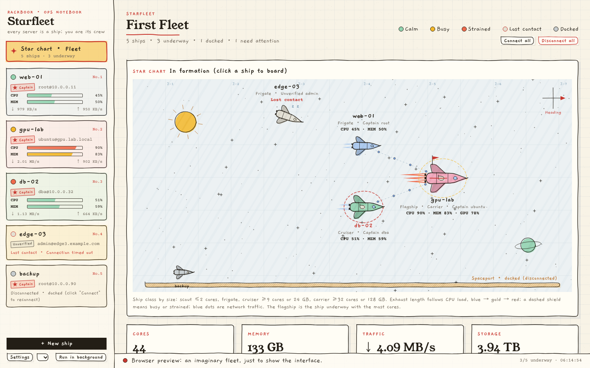
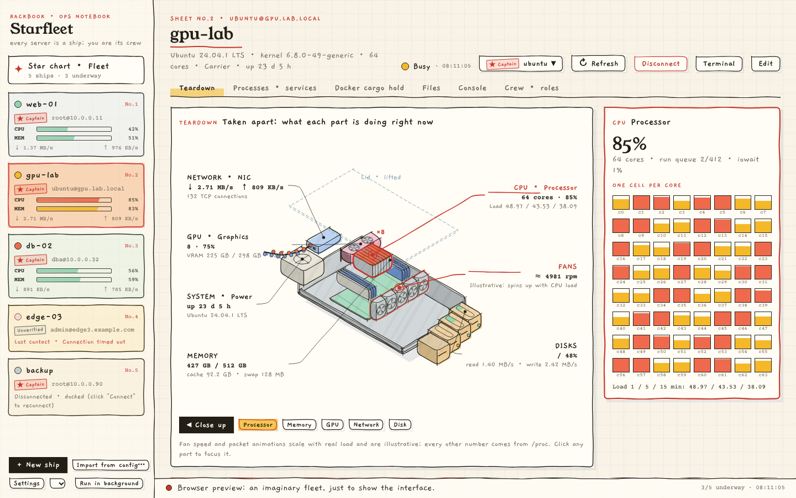
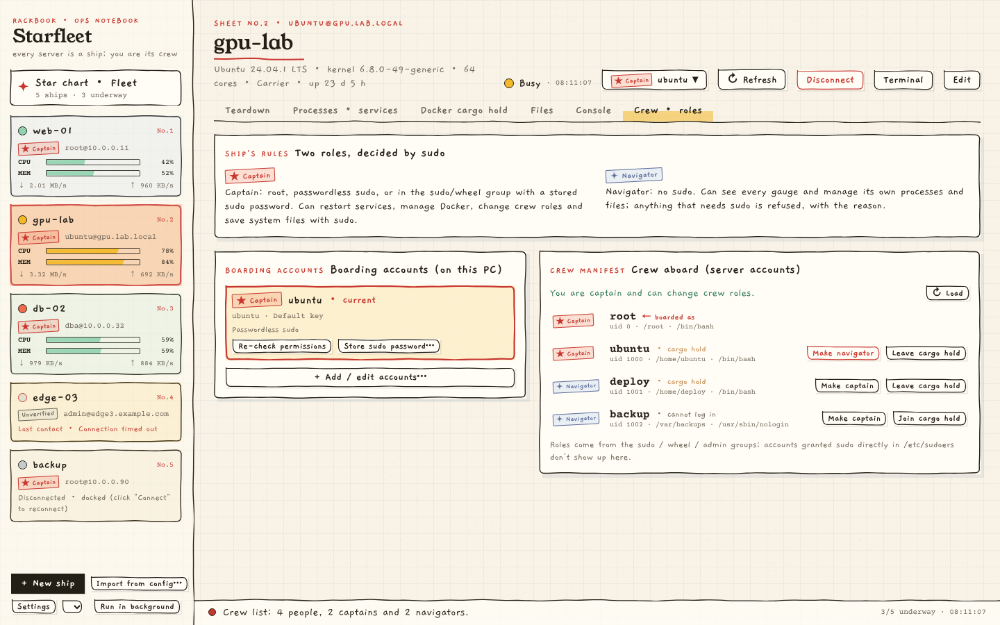
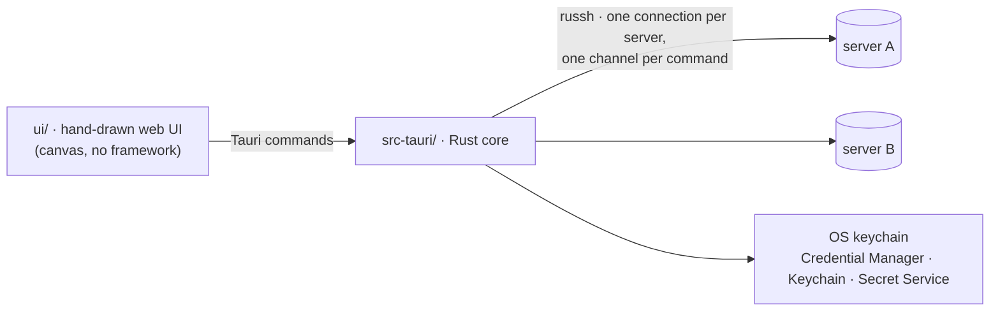

<p align="center">
  
</p>

<h1 align="center">Rackbook</h1>

<p align="center"><b>A hand-drawn control room for your servers.</b><br>
Monitor and manage a whole fleet over plain SSH, drawn in marker and pencil.<br>
Windows · macOS · Ubuntu.</p>

<p align="center">
  <a href="README.md"></a>
  <a href="docs/i18n/README.ja.md"></a>
  <a href="docs/i18n/README.es.md"></a>
  <a href="docs/i18n/README.zh-CN.md"></a>
  <a href="docs/i18n/README.zh-TW.md"></a>
  <a href="docs/i18n/README.ko.md"></a>
</p>

<p align="center">
  <a href="https://github.com/CrianeZRX/rackbook/releases/latest"></a>
  <a href="https://github.com/CrianeZRX/rackbook/actions/workflows/build.yml"></a>
  
  <a href="LICENSE"></a>
</p>

<p align="center">
  
</p>

<p align="center">
  <a href="https://crianezrx.github.io/rackbook/teardown/"><b>▶ Take the server apart yourself</b></a> (interactive 3D)
  &nbsp;·&nbsp;
  <a href="https://crianezrx.github.io/rackbook/demo/"><b>▶ Try Rackbook in your browser</b></a> (an imaginary fleet)
  &nbsp;·&nbsp;
  <a href="docs/media/teardown.mp4">Full film with sound</a>
</p>

---

## Why Rackbook

Most server dashboards are walls of identical grey charts. Rackbook draws each server as a ship in a star fleet and as a machine you can take apart, so you can tell at a glance which one is straining and why.

- **Nothing to install on your servers.** Rackbook talks plain SSH and reads `/proc`. If you can `ssh` in, you can watch it.
- **See it, then fix it.** Processes, services, Docker containers, files and config are all in the same window. You can restart, stop, edit and upload without opening a terminal.
- **Safe by default.** Every account is either a *captain* (has sudo) or a *navigator* (read and own processes only), decided by what sudo really allows. Passwords stay in your system keychain.
- **Stays out of the way.** Close the window and it keeps watch from the tray, with an optional floating panel that only appears when you're working in something else.

## A tour

<table>
<tr>
<td width="50%"><br><b>Star chart.</b> Each server is a ship. Size is its class (cores and memory), the exhaust is CPU load, a dashed shield means it needs attention, and blue dots are network traffic. Docked ships are disconnected.</td>
<td width="50%"><br><b>Teardown.</b> An isometric exploded view of the machine: CPU with one cell per core, memory, GPU, network, disks, fans. Click a part for its history.</td>
</tr>
<tr>
<td><br><b>Docker cargo hold.</b> Containers with live CPU, memory and network, plus start, stop, restart, logs and images. It uses sudo automatically when your account isn't in the <code>docker</code> group.</td>
<td><br><b>Visual editor.</b> YAML, JSON, shell rc files, INI and text, with syntax colouring, a clickable structure outline and a server-side syntax check. It checks for conflicts and makes a backup before saving.</td>
</tr>
<tr>
<td><br><b>Processes & services.</b> Sort, filter and signal processes, and start, stop or restart systemd services.</td>
<td><br><b>Crew & roles.</b> Switch the account you board with, see every user on the server, and promote or demote crew (captains only).</td>
</tr>
</table>

<p align="center">
  <br>
  <sub>The floating panel: drag it anywhere, double-click a ship to board it, right-click for options. You choose which metrics and ships it shows.</sub>
</p>

### Six languages, one hand

English · 日本語 · Español · 简体中文 · 繁體中文 · 한국어. Switch languages from the sidebar or Settings, and the tray menu follows. Every script is drawn in a matching handwritten face (Gaegu, Yomogi, ZCOOL KuaiLe and LXGW WenKai TC). All the fonts ship inside the app, so it works offline. Your own server names, paths and command output are never translated.

<p align="center"></p>

## Download

Grab the installer for your system from **[Releases](https://github.com/CrianeZRX/rackbook/releases/latest)**:

| System | File |
|---|---|
| Windows 10 / 11 (x64) | `Rackbook_<version>_x64-setup.exe`, or the `.msi` |
| macOS 10.15+ (Intel & Apple silicon) | `Rackbook_<version>_universal.dmg` |
| Ubuntu 22.04+ (x64) | `rackbook_<version>_amd64.deb`, or the `.AppImage` |

> **macOS:** the app isn't notarised yet. If macOS says it's damaged or can't be opened, run
> `xattr -cr /Applications/Rackbook.app` once, or right-click the app and choose **Open**.
>
> **Ubuntu:** `sudo apt install ./rackbook_*.deb`. Passwords are kept in GNOME Keyring or KWallet.

## Getting started

1. Click **+ New ship** and enter the host, port and user. Or click **Import from config…** to pick servers from your `~/.ssh/config` (and PuTTY sessions on Windows) in one go.
2. Choose **Key** (Rackbook tries your usual `~/.ssh` keys if you leave the path empty) or **Password**.
3. Rackbook checks what `sudo` allows and makes the account a **captain** or a **navigator**. Captains can store a sudo password so they can act without being asked each time.
4. Board the ship (click it) to open its teardown, processes, Docker, files, console and crew.

On first contact, a host's SSH fingerprint is trusted and remembered (trust on first use). If it changes later, Rackbook refuses to connect.

## How it works



- One collector script reads `/proc`, `df`, `ip` and, when present, `nvidia-smi` or amdgpu sysfs and `docker stats`. It runs every few seconds over an existing connection.
- Each command opens its own channel, so a slow `docker logs` never blocks the gauges.
- Uploads and downloads stream through `cat` and `tar`, so there's no SFTP subsystem to configure.

## Build from source

You need [Rust](https://rustup.rs) (stable) and Node.js 20+.

```bash
npm install
npx tauri dev       # run it
npx tauri build     # make an installer for this system
```

- **Ubuntu:** `sudo apt install libwebkit2gtk-4.1-dev libayatana-appindicator3-dev librsvg2-dev libdbus-1-dev patchelf`
- **macOS universal:** `rustup target add aarch64-apple-darwin x86_64-apple-darwin && npx tauri build --target universal-apple-darwin`
- **Only the UI:** serve `ui/` with any static server (`python3 -m http.server`) and open `index.html`. Without the Rust core it runs on a built-in imaginary fleet.

Pushing a `v*` tag builds all three platforms in GitHub Actions and attaches the installers to a release.

## The teardown film

The opening film and the [interactive 3D page](https://crianezrx.github.io/rackbook/teardown/) are built from code in [`showcase/`](showcase/) with the [teardown](https://github.com/elvarofficial/teardown) kit. The machine is a 2U, two-socket, 12-bay server with real part dimensions. One input, the workload, drives everything: CPU and GPU power, the fan speed needed to keep a 20 °F rise front to back (CFM = 3.16 × W / ΔT), heatsink temperatures with their thermal lag, wall power through a 94 % PSU, disk and network traffic, and the LEDs. The power and thermal figures are an illustrative model built from the parts' ratings, not measurements of one machine.

## Repository layout

```
src-tauri/            Rust core: SSH, collector, keychain, tray and windows
ui/                   The app's front end: plain JS + a canvas drawing kit, no build step
  js/i18n.js          Runtime translation (dictionary in js/i18n-dict.js)
  fonts/              Bundled handwritten fonts (SIL OFL)
showcase/             The 3D teardown film and page (three.js)
docs/                 Screenshots, media and translated READMEs
legacy/macos-swiftui/ The original native SwiftUI macOS app (1.x), kept for reference
```

## Contributing

Issues and pull requests are welcome. Translations are especially welcome: every string lives in `ui/js/i18n-dict.js` as `"简体中文 source": [en, ja, es, ko, zh-TW]`.

## License

[MIT](LICENSE). The bundled fonts are under the SIL Open Font License 1.1 (see [ui/fonts/FONTS-LICENSE.md](ui/fonts/FONTS-LICENSE.md)). The showcase uses the MIT-licensed [teardown](https://github.com/elvarofficial/teardown) kit and [three.js](https://threejs.org).
