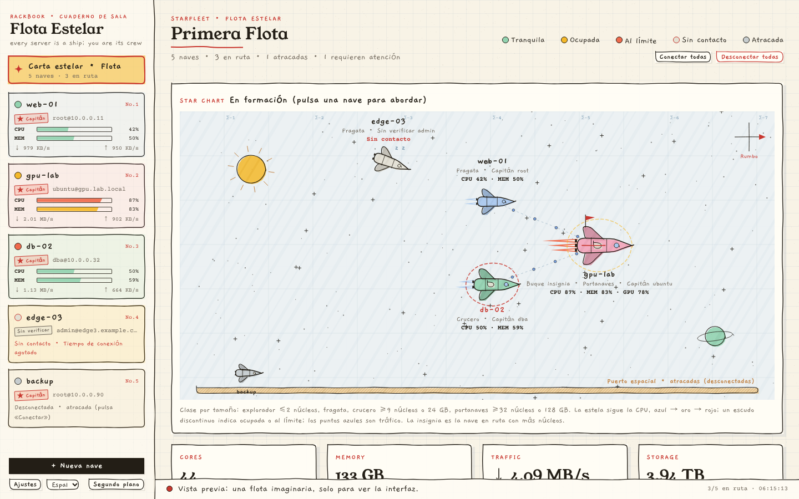
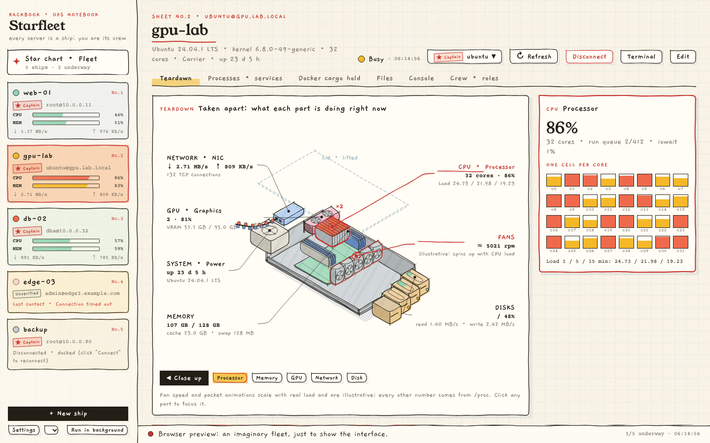
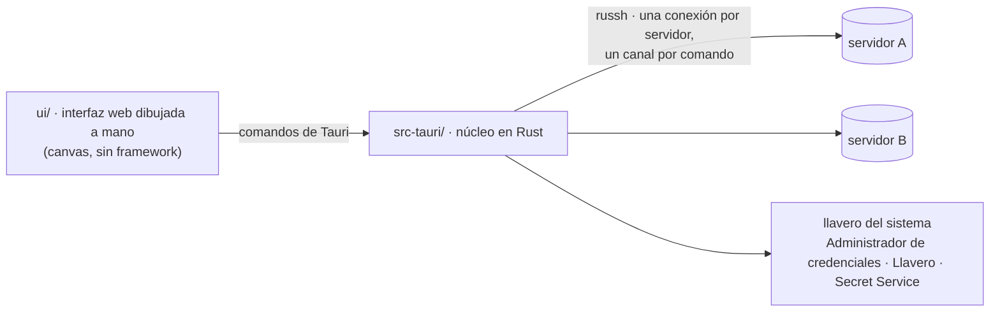

<p align="center">
  
</p>

<h1 align="center">Rackbook</h1>

<p align="center"><b>Una sala de control dibujada a mano para tus servidores.</b><br>
Vigila y gestiona toda una flota con SSH normal y corriente, dibujada con rotulador y lápiz.<br>
Windows · macOS · Ubuntu.</p>

<p align="center">
  <a href="../../README.md"></a>
  <a href="README.ja.md"></a>
  <a href="README.es.md"></a>
  <a href="README.zh-CN.md"></a>
  <a href="README.zh-TW.md"></a>
  <a href="README.ko.md"></a>
</p>

<p align="center">
  <a href="https://github.com/CrianeZRX/rackbook/releases/latest"></a>
  <a href="https://github.com/CrianeZRX/rackbook/actions/workflows/build.yml"></a>
  
  <a href="../../LICENSE"></a>
</p>

<p align="center">
  
</p>

<p align="center">
  <a href="https://crianezrx.github.io/rackbook/teardown/"><b>▶ Desmonta el servidor tú mismo</b></a> (3D interactivo)
  &nbsp;·&nbsp;
  <a href="https://crianezrx.github.io/rackbook/demo/"><b>▶ Prueba Rackbook en el navegador</b></a> (una flota imaginaria)
  &nbsp;·&nbsp;
  <a href="../media/teardown.mp4">Película completa con sonido</a>
</p>

---

## Por qué Rackbook

Casi todos los paneles de servidores son paredes de gráficas grises idénticas. Rackbook dibuja cada servidor como una nave de una flota estelar y como una máquina que puedes desmontar, así que ves de un vistazo cuál va al límite y por qué.

- **Nada que instalar en tus servidores.** Rackbook habla SSH y lee `/proc`. Si puedes entrar con `ssh`, puedes vigilarlo.
- **Lo ves y lo arreglas.** Procesos, servicios, contenedores Docker, archivos y configuración en la misma ventana. Puedes reiniciar, detener, editar y subir archivos sin abrir una terminal.
- **Seguro por defecto.** Cada cuenta es *capitán* (tiene sudo) o *navegante* (solo lectura y sus propios procesos), según lo que sudo permite de verdad. Las contraseñas se quedan en el llavero del sistema.
- **No estorba.** Cierra la ventana y sigue de guardia desde la bandeja, con un panel flotante opcional que solo aparece cuando trabajas en otra cosa.

## Un recorrido

<table>
<tr>
<td width="50%"><br><b>Carta estelar.</b> Cada servidor es una nave. El tamaño es su clase (núcleos y memoria), la estela es la carga de CPU, un escudo discontinuo pide atención y los puntos azules son tráfico de red. Las naves atracadas están desconectadas.</td>
<td width="50%"><br><b>Despiece.</b> Una vista isométrica explotada de la máquina: CPU con una celda por núcleo, memoria, GPU, red, discos y ventiladores. Pulsa una pieza para ver su historial.</td>
</tr>
<tr>
<td><br><b>Bodega Docker.</b> Contenedores con CPU, memoria y red en vivo, más iniciar, detener, reiniciar, registros e imágenes. Usa sudo automáticamente si tu cuenta no está en el grupo <code>docker</code>.</td>
<td><br><b>Editor visual.</b> YAML, JSON, archivos rc de la shell, INI y texto, con colores de sintaxis, un esquema de estructura clicable y comprobación de sintaxis en el servidor. Antes de guardar comprueba conflictos y hace una copia.</td>
</tr>
<tr>
<td><br><b>Procesos y servicios.</b> Ordena, filtra y envía señales a procesos; inicia, detén o reinicia servicios de systemd.</td>
<td><br><b>Tripulación y roles.</b> Cambia la cuenta con la que abordas, ve todos los usuarios del servidor y asciende o degrada a la tripulación (solo capitanes).</td>
</tr>
</table>

<p align="center">
  <br>
  <sub>El panel flotante: arrástralo a donde quieras, doble clic en una nave para abordarla, clic derecho para opciones. Tú eliges qué métricas y qué naves muestra.</sub>
</p>

### Seis idiomas, una misma letra

English · 日本語 · Español · 简体中文 · 繁體中文 · 한국어. Cambia de idioma desde la barra lateral o los Ajustes, y el menú de la bandeja también cambia. Cada escritura usa una letra manuscrita a juego (Gaegu, Yomogi, ZCOOL KuaiLe y LXGW WenKai TC). Todas las fuentes van dentro de la app, así que funciona sin conexión. Los nombres de tus servidores, las rutas y la salida de los comandos nunca se traducen.

<p align="center"></p>

## Descarga

Descarga el instalador para tu sistema en **[Releases](https://github.com/CrianeZRX/rackbook/releases/latest)**:

| Sistema | Archivo |
|---|---|
| Windows 10 / 11 (x64) | `Rackbook_<versión>_x64-setup.exe` o el `.msi` |
| macOS 10.15+ (Intel y Apple silicon) | `Rackbook_<versión>_universal.dmg` |
| Ubuntu 22.04+ (x64) | `rackbook_<versión>_amd64.deb` o el `.AppImage` |

> **macOS:** la app aún no está notarizada. Si macOS dice que está dañada o que no se puede abrir, ejecuta una vez
> `xattr -cr /Applications/Rackbook.app`, o haz clic derecho en la app y elige **Abrir**.
>
> **Ubuntu:** `sudo apt install ./rackbook_*.deb`. Las contraseñas se guardan en GNOME Keyring o KWallet.

## Primeros pasos

1. Pulsa **+ Nueva nave** e indica host, puerto y usuario.
2. Elige **Clave** (si dejas la ruta vacía, Rackbook prueba tus claves habituales de `~/.ssh`) o **Contraseña**.
3. Rackbook comprueba lo que permite `sudo` y convierte la cuenta en **capitán** o **navegante**. Los capitanes pueden guardar una contraseña de sudo para no tener que escribirla cada vez.
4. Aborda la nave (haz clic en ella) para abrir su despiece, procesos, Docker, archivos, consola y tripulación.

En la primera conexión, la huella SSH del host se acepta y se recuerda (confianza en el primer uso). Si cambia más adelante, Rackbook se niega a conectar.

## Cómo funciona



- Un único script de recogida lee `/proc`, `df`, `ip` y, si existen, `nvidia-smi` o amdgpu sysfs y `docker stats`. Se ejecuta cada pocos segundos sobre una conexión ya abierta.
- Cada comando abre su propio canal, así que un `docker logs` lento nunca bloquea los indicadores.
- Las subidas y descargas viajan por `cat` y `tar`, sin subsistema SFTP que configurar.

## Compilar desde el código

Necesitas [Rust](https://rustup.rs) (stable) y Node.js 20 o superior.

```bash
npm install
npx tauri dev       # ejecutarla
npx tauri build     # crear un instalador para este sistema
```

- **Ubuntu:** `sudo apt install libwebkit2gtk-4.1-dev libayatana-appindicator3-dev librsvg2-dev libdbus-1-dev patchelf`
- **macOS universal:** `rustup target add aarch64-apple-darwin x86_64-apple-darwin && npx tauri build --target universal-apple-darwin`
- **Solo la interfaz:** sirve `ui/` con cualquier servidor estático (`python3 -m http.server`) y abre `index.html`. Sin el núcleo en Rust funciona con una flota imaginaria incluida.

Al subir una etiqueta `v*`, GitHub Actions compila las tres plataformas y adjunta los instaladores a una release.

## La película del despiece

La película inicial y la [página 3D interactiva](https://crianezrx.github.io/rackbook/teardown/) se generan con el código de [`showcase/`](../../showcase/) y el kit [teardown](https://github.com/elvarofficial/teardown). La máquina es un servidor 2U de dos zócalos y 12 bahías con las medidas reales de sus piezas. Una sola entrada, la carga de trabajo, lo mueve todo: la potencia de CPU y GPU, la velocidad de ventilador necesaria para mantener 20 °F de subida de delante a atrás (CFM = 3,16 × W / ΔT), la temperatura de los disipadores con su inercia térmica, la potencia en el enchufe tras una fuente del 94 %, el tráfico de disco y de red, y los LED. Las cifras de potencia y temperatura son un modelo ilustrativo construido a partir de las especificaciones de las piezas, no medidas de una máquina concreta.

## Estructura del repositorio

```
src-tauri/            Núcleo en Rust: SSH, recogida, llavero, bandeja y ventanas
ui/                   El front-end de la app: JS plano + un kit de dibujo en canvas, sin compilación
  js/i18n.js          Traducción en tiempo de ejecución (diccionario en js/i18n-dict.js)
  fonts/              Fuentes manuscritas incluidas (SIL OFL)
showcase/             La película y la página 3D del despiece (three.js)
docs/                 Capturas, medios y README traducidos
legacy/macos-swiftui/ La app nativa original en SwiftUI para macOS (1.x), como referencia
```

## Contribuir

Issues y pull requests son bienvenidos, y las traducciones especialmente: todos los textos están en `ui/js/i18n-dict.js` como `"texto original en chino simplificado": [en, ja, es, ko, zh-TW]`.

## Licencia

[MIT](../../LICENSE). Las fuentes incluidas usan la SIL Open Font License 1.1 (consulta [ui/fonts/FONTS-LICENSE.md](../../ui/fonts/FONTS-LICENSE.md)). El showcase usa el kit [teardown](https://github.com/elvarofficial/teardown), con licencia MIT, y [three.js](https://threejs.org).
