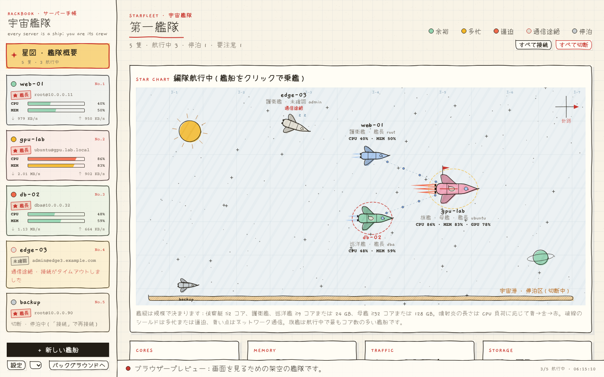
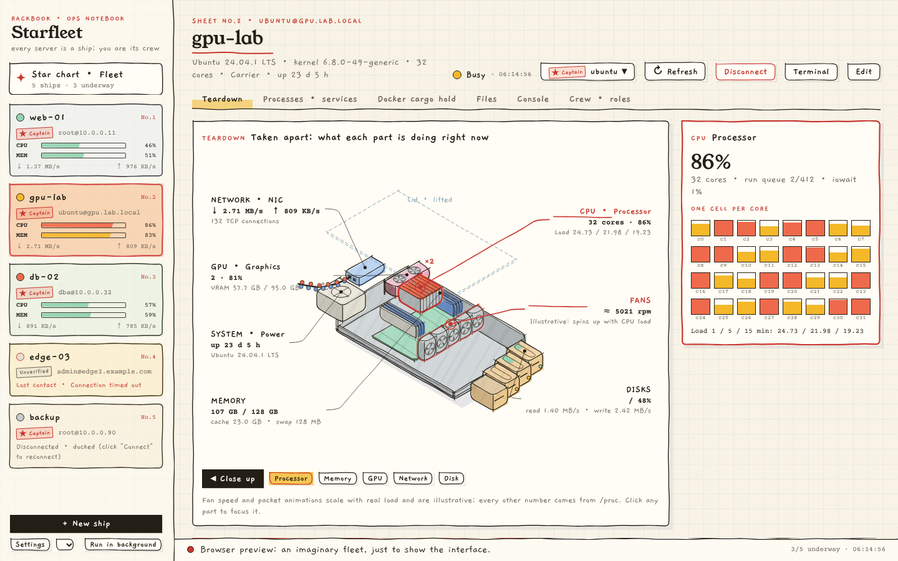
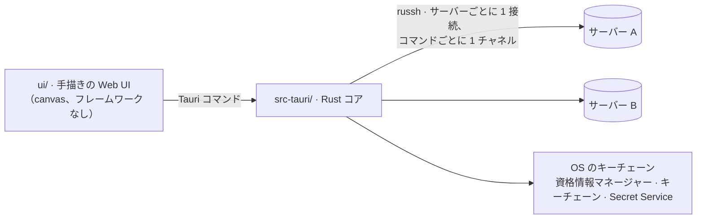

<p align="center">
  
</p>

<h1 align="center">Rackbook</h1>

<p align="center"><b>サーバーのための、手描きのコントロールルーム。</b><br>
ふつうの SSH だけで、サーバー艦隊をまるごと監視・管理。画面はマーカーと鉛筆で描かれています。<br>
Windows · macOS · Ubuntu</p>

<p align="center">
  <a href="../../README.md"></a>
  <a href="README.ja.md"></a>
  <a href="README.es.md"></a>
  <a href="README.zh-CN.md"></a>
  <a href="README.zh-TW.md"></a>
  <a href="README.ko.md"></a>
</p>

<p align="center">
  <a href="https://github.com/CrianeZRX/rackbook/releases/latest"></a>
  <a href="https://github.com/CrianeZRX/rackbook/actions/workflows/build.yml"></a>
  
  <a href="../../LICENSE"></a>
</p>

<p align="center">
  
</p>

<p align="center">
  <a href="https://crianezrx.github.io/rackbook/teardown/"><b>▶ 自分でサーバーを分解する</b></a>（インタラクティブ 3D）
  &nbsp;·&nbsp;
  <a href="https://crianezrx.github.io/rackbook/demo/"><b>▶ ブラウザで Rackbook を試す</b></a>（架空の艦隊）
  &nbsp;·&nbsp;
  <a href="../media/teardown.mp4">音付きのフル映像</a>
</p>

---

## なぜ Rackbook？

ほとんどのサーバーダッシュボードは、同じような灰色のグラフが並んだ壁です。Rackbook は各サーバーを宇宙艦隊の一隻として、そして分解できる一台の機械として描きます。どれが苦しんでいるのか、なぜなのかが一目でわかります。

- **サーバー側には何もインストール不要。** 使うのは SSH と `/proc` だけ。`ssh` で入れるマシンなら見られます。
- **見たら、そのまま手を打てる。** プロセス、サービス、Docker コンテナ、ファイル、設定がひとつのウィンドウに。再起動・停止・編集・アップロードもターミナルを開かずにできます。
- **最初から安全。** 各アカウントは sudo で実際にできることに応じて「艦長」（sudo あり）か「航海士」（閲覧と自分のプロセスのみ）になります。パスワードは OS のキーチェーンにだけ保存されます。
- **邪魔をしない。** ウィンドウを閉じてもトレイから見張りを続けます。ほかの作業中だけ現れるフローティングパネルも使えます。

## ツアー

<table>
<tr>
<td width="50%"><br><b>星図。</b>サーバーは一隻の艦船です。大きさは艦級（コア数とメモリ）、噴射炎は CPU 負荷、破線のシールドは要注意、青い点はネットワーク通信。停泊中の艦は切断済みです。</td>
<td width="50%"><br><b>分解図。</b>等角投影でマシンを分解：コアごとに 1 マスの CPU、メモリ、GPU、ネットワーク、ディスク、ファン。部品をクリックすると履歴が見られます。</td>
</tr>
<tr>
<td><br><b>Docker 貨物室。</b>コンテナの CPU・メモリ・ネットワークをライブ表示。起動・停止・再起動・ログ・イメージ管理。<code>docker</code> グループに入っていないアカウントでは自動で sudo を使います。</td>
<td><br><b>ビジュアルエディタ。</b>YAML、JSON、シェルの設定ファイル、INI、テキスト。シンタックスハイライト、クリックできる構造アウトライン、サーバー側の構文チェック。保存前に競合を確認し、バックアップを作ります。</td>
</tr>
<tr>
<td><br><b>プロセスとサービス。</b>並べ替え・絞り込み・シグナル送信、systemd サービスの起動・停止・再起動。</td>
<td><br><b>乗組員と役割。</b>乗艦するアカウントの切り替え、サーバー上の全ユーザーの確認、乗組員の昇格・降格（艦長のみ）。</td>
</tr>
</table>

<p align="center">
  <br>
  <sub>フローティングパネル：どこへでもドラッグ、艦船をダブルクリックで乗艦、右クリックでオプション。表示する指標と艦船は自由に選べます。</sub>
</p>

### 6 つの言語、ひとつの筆跡

English · 日本語 · Español · 简体中文 · 繁體中文 · 한국어。サイドバーか設定で切り替えると、トレイのメニューも切り替わります。どの文字にも雰囲気をそろえた手書きフォント（Gaegu、Yomogi、ZCOOL KuaiLe、LXGW WenKai TC）を用意しました。フォントはすべてアプリに同梱されているので、オフラインでも使えます。サーバー名、パス、コマンドの出力は翻訳されません。

<p align="center"></p>

## ダウンロード

**[Releases](https://github.com/CrianeZRX/rackbook/releases/latest)** からお使いのシステム用のインストーラーを入手してください。

| システム | ファイル |
|---|---|
| Windows 10 / 11（x64） | `Rackbook_<バージョン>_x64-setup.exe` または `.msi` |
| macOS 10.15+（Intel と Apple シリコン） | `Rackbook_<バージョン>_universal.dmg` |
| Ubuntu 22.04+（x64） | `rackbook_<バージョン>_amd64.deb` または `.AppImage` |

> **macOS：** まだ公証を受けていません。「壊れている」「開けません」と表示されたら、一度だけ
> `xattr -cr /Applications/Rackbook.app` を実行するか、アプリを右クリックして「開く」を選んでください。
>
> **Ubuntu：** `sudo apt install ./rackbook_*.deb`。パスワードは GNOME キーリングか KWallet に保存されます。

## はじめかた

1. 「＋ 新しい艦船」を押し、ホスト・ポート・ユーザーを入力します。
2. 「鍵」（パスを空にすると `~/.ssh` のいつもの鍵を試します）か「パスワード」を選びます。
3. Rackbook が `sudo` で何ができるかを調べ、アカウントを「艦長」か「航海士」にします。艦長は sudo パスワードを保存しておけば、毎回聞かれずに操作できます。
4. 艦船をクリックして乗艦すると、分解図・プロセス・Docker・ファイル・コンソール・乗組員が開きます。

最初の接続でホストの SSH フィンガープリントを信頼して記憶します（TOFU）。あとで変わった場合、Rackbook は接続を拒否します。

## しくみ



- ひとつの収集スクリプトが `/proc`、`df`、`ip`、あれば `nvidia-smi` または amdgpu sysfs と `docker stats` を読み、既存の接続上で数秒ごとに実行されます。
- コマンドごとにチャネルを開くので、遅い `docker logs` がメーターを止めることはありません。
- アップロードとダウンロードは `cat` と `tar` でストリーム転送するので、SFTP の設定は不要です。

## ソースからビルド

[Rust](https://rustup.rs)（stable）と Node.js 20 以上が必要です。

```bash
npm install
npx tauri dev       # 起動
npx tauri build     # このシステム用のインストーラーを作る
```

- **Ubuntu：** `sudo apt install libwebkit2gtk-4.1-dev libayatana-appindicator3-dev librsvg2-dev libdbus-1-dev patchelf`
- **macOS ユニバーサル：** `rustup target add aarch64-apple-darwin x86_64-apple-darwin && npx tauri build --target universal-apple-darwin`
- **UI だけ：** 任意の静的サーバー（`python3 -m http.server` など）で `ui/` を配信して `index.html` を開きます。Rust コアがなければ、内蔵の架空の艦隊で動きます。

`v*` タグを push すると、GitHub Actions が 3 つのプラットフォームでビルドし、インストーラーをリリースに添付します。

## 分解映像について

冒頭の映像と[インタラクティブ 3D ページ](https://crianezrx.github.io/rackbook/teardown/)は、[`showcase/`](../../showcase/) のコードから [teardown](https://github.com/elvarofficial/teardown) キットで作られています。モデルは実際の部品寸法で組んだ 2U・2 ソケット・12 ベイのサーバーです。入力はひとつ、負荷だけ。それが CPU と GPU の電力、前後の温度上昇を 20 °F に保つのに必要なファン回転数（CFM = 3.16 × W / ΔT）、熱の遅れを含むヒートシンク温度、94 % の電源を通したコンセント側の電力、ディスクとネットワークの通信量、LED まですべてを動かします。電力と温度の値は部品の定格から作った説明用のモデルで、特定のマシンの実測値ではありません。

## リポジトリ構成

```
src-tauri/            Rust コア：SSH、収集、キーチェーン、トレイとウィンドウ
ui/                   アプリのフロントエンド：素の JS + canvas の手描きキット、ビルド不要
  js/i18n.js          実行時翻訳（辞書は js/i18n-dict.js）
  fonts/              同梱の手書きフォント（SIL OFL）
showcase/             3D 分解映像とページ（three.js）
docs/                 スクリーンショット、メディア、各言語の README
legacy/macos-swiftui/ 最初のネイティブ SwiftUI 版 macOS アプリ（1.x）、参考用
```

## コントリビュート

Issue と Pull Request を歓迎します。特に翻訳は大歓迎です。すべての文言は `ui/js/i18n-dict.js` に `"简体中文の原文": [en, ja, es, ko, zh-TW]` の形で入っています。

## ライセンス

[MIT](../../LICENSE)。同梱フォントは SIL Open Font License 1.1 です（[ui/fonts/FONTS-LICENSE.md](../../ui/fonts/FONTS-LICENSE.md) を参照）。ショーケースには MIT ライセンスの [teardown](https://github.com/elvarofficial/teardown) キットと [three.js](https://threejs.org) を使っています。
