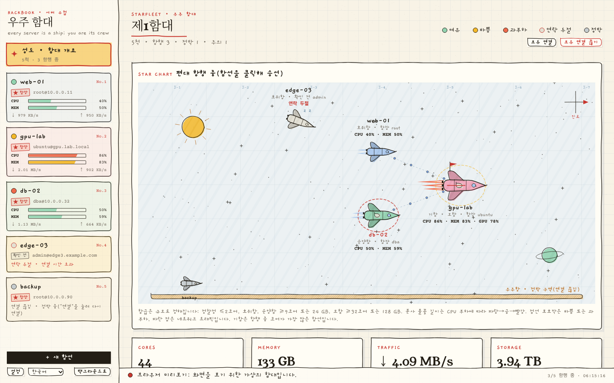
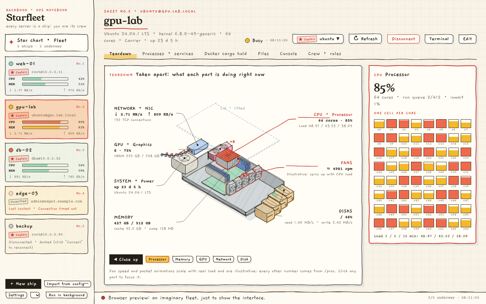
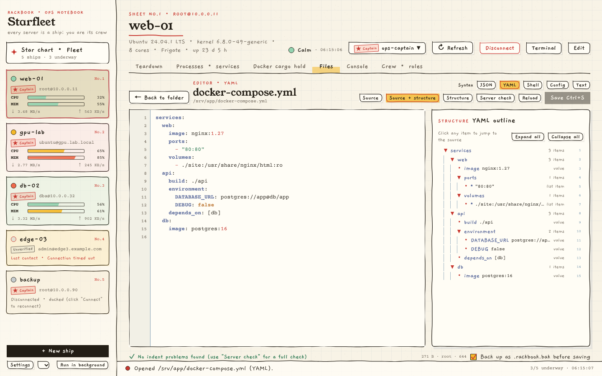
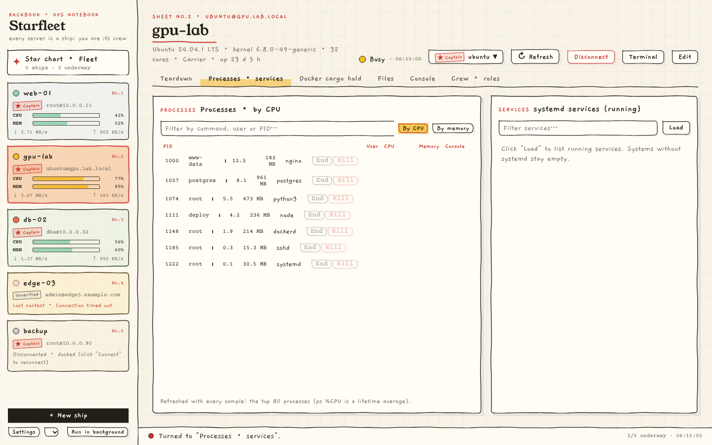
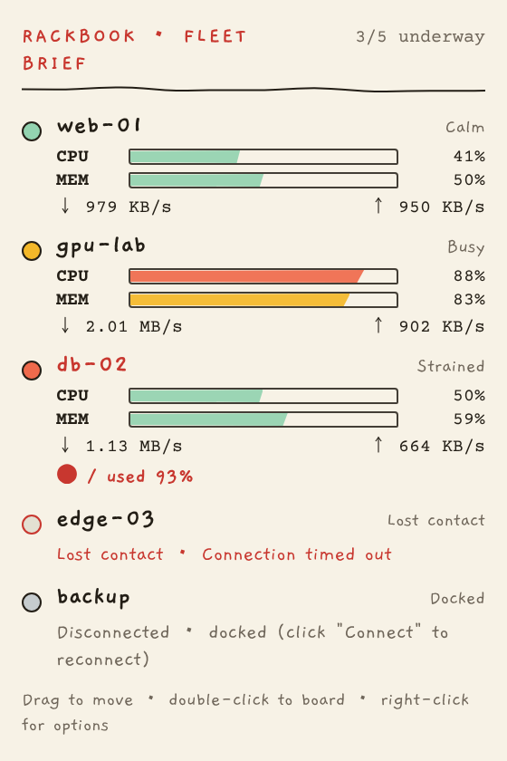
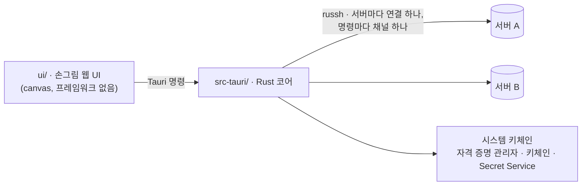

<p align="center">
  
</p>

<h1 align="center">Rackbook</h1>

<p align="center"><b>서버를 위한 손그림 관제실.</b><br>
평범한 SSH만으로 서버 함대 전체를 모니터링하고 관리하세요. 화면은 마커와 연필로 그려져 있습니다.<br>
Windows · macOS · Ubuntu</p>

<p align="center">
  <a href="../../README.md"></a>
  <a href="README.ja.md"></a>
  <a href="README.es.md"></a>
  <a href="README.zh-CN.md"></a>
  <a href="README.zh-TW.md"></a>
  <a href="README.ko.md"></a>
</p>

<p align="center">
  <a href="https://github.com/CrianeZRX/rackbook/releases/latest"></a>
  <a href="https://github.com/CrianeZRX/rackbook/actions/workflows/build.yml"></a>
  
  <a href="../../LICENSE"></a>
</p>

<p align="center">
  
</p>

<p align="center">
  <a href="https://crianezrx.github.io/rackbook/teardown/"><b>▶ 직접 서버 분해하기</b></a> (인터랙티브 3D)
  &nbsp;·&nbsp;
  <a href="https://crianezrx.github.io/rackbook/demo/"><b>▶ 브라우저에서 Rackbook 써 보기</b></a> (가상의 함대)
  &nbsp;·&nbsp;
  <a href="../media/teardown.mp4">소리가 있는 전체 영상</a>
</p>

---

## 왜 Rackbook인가

대부분의 서버 대시보드는 똑같은 회색 그래프가 가득한 벽입니다. Rackbook은 각 서버를 우주 함대의 함선으로, 그리고 분해해 볼 수 있는 기계로 그립니다. 어느 서버가 버거워하는지, 왜 그런지 한눈에 보입니다.

- **서버에 설치할 것이 없습니다.** Rackbook은 SSH로 접속해 `/proc`을 읽습니다. `ssh`로 들어갈 수 있으면 지켜볼 수 있습니다.
- **보고, 바로 고칩니다.** 프로세스, 서비스, Docker 컨테이너, 파일과 설정이 한 창에 있습니다. 터미널을 열지 않고도 재시작, 중지, 편집, 업로드를 할 수 있습니다.
- **기본부터 안전합니다.** 모든 계정은 sudo가 실제로 허용하는 범위에 따라 *함장*(sudo 있음) 또는 *항해사*(조회와 자기 프로세스만)가 됩니다. 비밀번호는 시스템 키체인에만 저장됩니다.
- **방해하지 않습니다.** 창을 닫아도 트레이에서 계속 당직을 섭니다. 다른 작업 중일 때만 나타나는 플로팅 창도 켤 수 있습니다.

## 둘러보기

<table>
<tr>
<td width="50%"><br><b>성도.</b> 서버 하나가 함선 한 척입니다. 크기는 함급(코어와 메모리), 분사 불꽃은 CPU 부하, 점선 방어막은 주의가 필요하다는 뜻, 파란 점은 네트워크 트래픽입니다. 정박한 함선은 연결이 끊긴 상태입니다.</td>
<td width="50%"><br><b>분해도.</b> 등각 투영으로 펼친 기계: 코어마다 한 칸인 CPU, 메모리, GPU, 네트워크, 디스크, 팬. 부품을 클릭하면 기록이 나옵니다.</td>
</tr>
<tr>
<td><br><b>Docker 화물칸.</b> 컨테이너의 CPU, 메모리, 네트워크를 실시간으로 보고 시작, 중지, 재시작, 로그, 이미지를 관리합니다. 계정이 <code>docker</code> 그룹에 없으면 자동으로 sudo를 씁니다.</td>
<td><br><b>비주얼 편집기.</b> YAML, JSON, 셸 rc 파일, INI, 텍스트를 구문 강조, 클릭할 수 있는 구조 개요, 서버 쪽 구문 검사와 함께 다룹니다. 저장 전에 충돌을 확인하고 백업을 만듭니다.</td>
</tr>
<tr>
<td><br><b>프로세스와 서비스.</b> 프로세스를 정렬, 필터링하고 시그널을 보내며, systemd 서비스를 시작, 중지, 재시작합니다.</td>
<td><br><b>승무원과 역할.</b> 승선할 계정을 바꾸고, 서버의 모든 사용자를 보고, 승무원을 승진·강등합니다(함장만).</td>
</tr>
</table>

<p align="center">
  <br>
  <sub>플로팅 창: 원하는 곳으로 끌어 놓고, 함선을 더블클릭하면 승선, 우클릭하면 옵션. 어떤 지표와 함선을 보여 줄지 직접 고릅니다.</sub>
</p>

### 여섯 가지 언어, 하나의 손글씨

English · 日本語 · Español · 简体中文 · 繁體中文 · 한국어. 사이드바나 설정에서 언어를 바꾸면 트레이 메뉴도 함께 바뀝니다. 문자마다 어울리는 손글씨 글꼴(Gaegu, Yomogi, ZCOOL KuaiLe, LXGW WenKai TC)을 씁니다. 모든 글꼴이 앱에 들어 있어 오프라인에서도 동작합니다. 서버 이름, 경로, 명령 출력은 번역하지 않습니다.

<p align="center"></p>

## 다운로드

**[Releases](https://github.com/CrianeZRX/rackbook/releases/latest)** 에서 시스템에 맞는 설치 파일을 받으세요.

| 시스템 | 파일 |
|---|---|
| Windows 10 / 11 (x64) | `Rackbook_<버전>_x64-setup.exe` 또는 `.msi` |
| macOS 10.15+ (Intel과 Apple 실리콘) | `Rackbook_<버전>_universal.dmg` |
| Ubuntu 22.04+ (x64) | `rackbook_<버전>_amd64.deb` 또는 `.AppImage` |

> **macOS:** 아직 공증을 받지 않았습니다. 손상되었다거나 열 수 없다는 메시지가 나오면 한 번만
> `xattr -cr /Applications/Rackbook.app` 을 실행하거나, 앱을 우클릭해 **열기**를 고르세요.
>
> **Ubuntu:** `sudo apt install ./rackbook_*.deb`. 비밀번호는 GNOME Keyring 또는 KWallet에 저장됩니다.

## 시작하기

1. **+ 새 함선**을 눌러 호스트, 포트, 사용자를 입력합니다. **설정에서 가져오기…**를 누르면 `~/.ssh/config`(Windows에서는 PuTTY 세션도)에서 한 번에 골라 추가할 수 있습니다.
2. **키**(경로를 비워 두면 `~/.ssh`의 기본 키를 시도합니다) 또는 **비밀번호**를 고릅니다.
3. Rackbook이 `sudo`가 무엇을 허용하는지 확인해 계정을 **함장** 또는 **항해사**로 정합니다. 함장은 sudo 비밀번호를 저장해 두면 매번 입력하지 않아도 됩니다.
4. 함선을 클릭해 승선하면 분해도, 프로세스, Docker, 파일, 콘솔, 승무원이 열립니다.

처음 접속할 때 호스트의 SSH 지문을 신뢰하고 기억합니다(TOFU). 나중에 지문이 바뀌면 Rackbook은 연결을 거부합니다.

## 동작 방식



- 수집 스크립트 하나가 `/proc`, `df`, `ip`와, 있다면 `nvidia-smi` 또는 amdgpu sysfs, `docker stats`를 읽습니다. 이미 열린 연결 위에서 몇 초마다 실행됩니다.
- 명령마다 자체 채널을 열기 때문에 느린 `docker logs`가 계기판을 막지 않습니다.
- 업로드와 다운로드는 `cat`과 `tar`로 스트리밍하므로 SFTP를 따로 설정할 필요가 없습니다.

## 소스에서 빌드

[Rust](https://rustup.rs)(stable)와 Node.js 20 이상이 필요합니다.

```bash
npm install
npx tauri dev       # 실행
npx tauri build     # 이 시스템용 설치 파일 만들기
```

- **Ubuntu:** `sudo apt install libwebkit2gtk-4.1-dev libayatana-appindicator3-dev librsvg2-dev libdbus-1-dev patchelf`
- **macOS 유니버설:** `rustup target add aarch64-apple-darwin x86_64-apple-darwin && npx tauri build --target universal-apple-darwin`
- **UI만:** 아무 정적 서버(`python3 -m http.server` 등)로 `ui/`를 열고 `index.html`을 엽니다. Rust 코어가 없으면 내장된 가상 함대로 동작합니다.

`v*` 태그를 푸시하면 GitHub Actions가 세 플랫폼을 빌드하고 설치 파일을 릴리스에 첨부합니다.

## 분해 영상

첫 영상과 [인터랙티브 3D 페이지](https://crianezrx.github.io/rackbook/teardown/)는 [`showcase/`](../../showcase/)의 코드와 [teardown](https://github.com/elvarofficial/teardown) 키트로 만들었습니다. 기계는 실제 부품 치수로 만든 2U, 2소켓, 12베이 서버입니다. 입력은 부하 하나뿐이고, 그 하나가 모든 것을 움직입니다. CPU와 GPU 전력, 앞뒤 온도 상승을 20 °F로 유지하는 데 필요한 팬 속도(CFM = 3.16 × W / ΔT), 열 지연이 있는 히트싱크 온도, 효율 94 % 전원을 거친 콘센트 전력, 디스크와 네트워크 트래픽, LED까지요. 전력과 온도 수치는 부품 정격으로 만든 설명용 모델이며, 특정 기계의 실측값이 아닙니다.

## 저장소 구조

```
src-tauri/            Rust 코어: SSH, 수집, 키체인, 트레이와 창
ui/                   앱 프런트엔드: 순수 JS + canvas 손그림 키트, 빌드 불필요
  js/i18n.js          실행 시 번역(사전은 js/i18n-dict.js)
  fonts/              내장 손글씨 글꼴(SIL OFL)
showcase/             3D 분해 영상과 페이지(three.js)
docs/                 스크린샷, 미디어, 번역된 README
legacy/macos-swiftui/ 처음 만든 네이티브 SwiftUI macOS 앱(1.x), 참고용
```

## 기여하기

이슈와 풀 리퀘스트를 환영합니다. 특히 번역을 환영합니다. 모든 문구는 `ui/js/i18n-dict.js`에 `"간체 중국어 원문": [en, ja, es, ko, zh-TW]` 형식으로 들어 있습니다.

## 라이선스

[MIT](../../LICENSE). 내장 글꼴은 SIL Open Font License 1.1을 따릅니다([ui/fonts/FONTS-LICENSE.md](../../ui/fonts/FONTS-LICENSE.md) 참고). 쇼케이스는 MIT 라이선스의 [teardown](https://github.com/elvarofficial/teardown) 키트와 [three.js](https://threejs.org)를 사용합니다.
