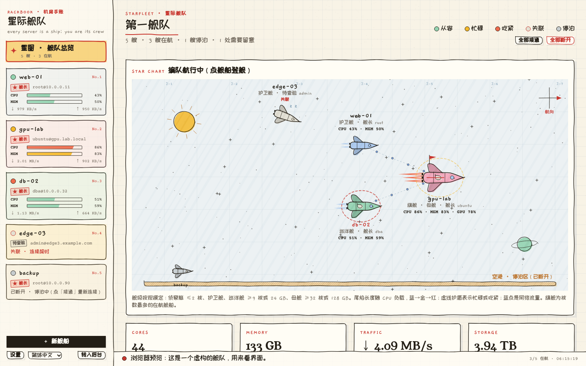
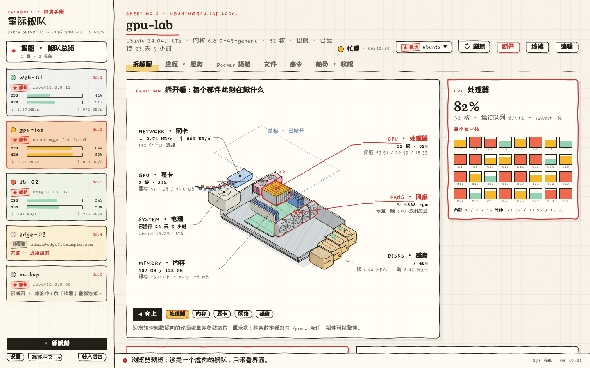
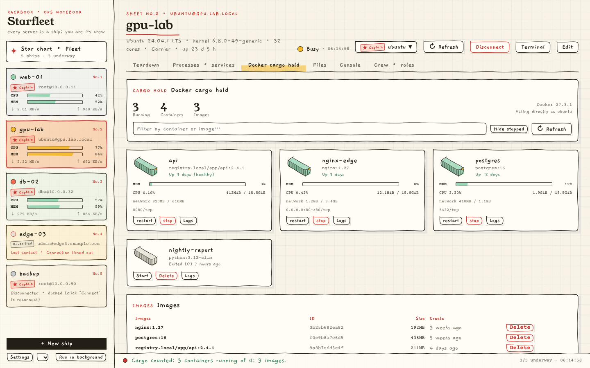
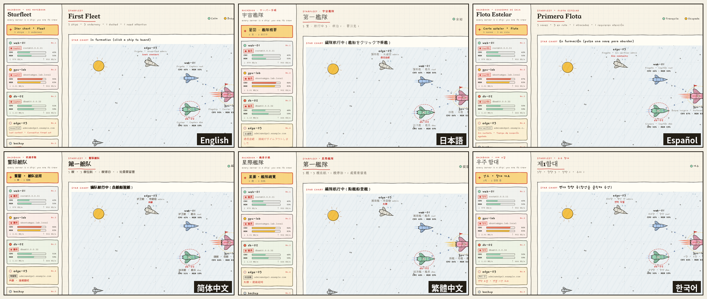
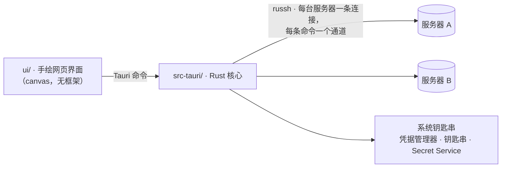

<p align="center">
  
</p>

<h1 align="center">Rackbook</h1>

<p align="center"><b>给服务器用的手绘控制室。</b><br>
用最普通的 SSH 监控和管理整支服务器舰队，界面是马克笔和铅笔画出来的。<br>
Windows · macOS · Ubuntu。</p>

<p align="center">
  <a href="../../README.md"></a>
  <a href="README.ja.md"></a>
  <a href="README.es.md"></a>
  <a href="README.zh-CN.md"></a>
  <a href="README.zh-TW.md"></a>
  <a href="README.ko.md"></a>
</p>

<p align="center">
  <a href="https://github.com/CrianeZRX/rackbook/releases/latest"></a>
  <a href="https://github.com/CrianeZRX/rackbook/actions/workflows/build.yml"></a>
  
  <a href="../../LICENSE"></a>
</p>

<p align="center">
  
</p>

<p align="center">
  <a href="https://crianezrx.github.io/rackbook/teardown/"><b>▶ 亲手拆一台服务器</b></a>（交互式 3D）
  &nbsp;·&nbsp;
  <a href="https://crianezrx.github.io/rackbook/demo/"><b>▶ 在浏览器里试用 Rackbook</b></a>（一支虚构舰队）
  &nbsp;·&nbsp;
  <a href="../media/teardown.mp4">带声音的完整影片</a>
</p>

---

## 为什么是 Rackbook

大多数服务器面板都是一墙一模一样的灰色曲线。Rackbook 把每台服务器画成星际舰队里的一艘舰船，也画成一台可以拆开的机器，哪台在吃紧、为什么吃紧，一眼就能看出来。

- **服务器上什么都不用装。** Rackbook 只用 SSH，读取 `/proc`。能 `ssh` 进去的机器就能看。
- **看到了就能动手。** 进程、服务、Docker 容器、文件和配置都在同一个窗口里，重启、停止、编辑、上传都不用另开终端。
- **默认就安全。** 每个账户按 sudo 实际允许的权限，分成「舰长」（有 sudo）或「领航员」（只能查看、只能管自己的进程）。密码只存在系统钥匙串里。
- **不打扰你。** 关掉窗口后它在托盘里继续值班；可选的悬浮窗只在你做别的事时出现。

## 功能一览

<table>
<tr>
<td width="50%"><br><b>星图。</b>每台服务器是一艘舰船：大小代表舰级（核数和内存），尾焰代表 CPU 负载，虚线护盾表示需要留意，蓝点是网络流量。停在港口的是已断开的舰船。</td>
<td width="50%"><br><b>拆解图。</b>等距视角的机器拆解：CPU 每个核一格，还有内存、GPU、网络、硬盘、风扇。点任意部件看它的历史曲线。</td>
</tr>
<tr>
<td><br><b>Docker 货舱。</b>容器的 CPU、内存、网络实时显示，可以启动、停止、重启、看日志、管理镜像。账户不在 <code>docker</code> 组时自动改用 sudo。</td>
<td><br><b>可视化编辑器。</b>支持 YAML、JSON、shell 配置、INI 和纯文本：语法着色、可点击的结构大纲、服务器端语法校验，保存前检查冲突并自动备份。</td>
</tr>
<tr>
<td><br><b>进程与服务。</b>排序、筛选、给进程发信号，启动、停止、重启 systemd 服务。</td>
<td><br><b>船员与角色。</b>切换登舰账户，查看服务器上的所有用户，舰长可以任免船员。</td>
</tr>
</table>

<p align="center">
  <br>
  <sub>悬浮窗：随意拖动，双击舰船登舰，右键打开选项。显示哪些指标、哪些舰船都由你决定。</sub>
</p>

### 六种语言，同一种笔迹

English · 日本語 · Español · 简体中文 · 繁體中文 · 한국어。在侧栏或设置里切换，托盘菜单跟着变。每种文字都配了风格一致的手写字体（Gaegu、Yomogi、站酷快乐体、霞鹜文楷 TC），全部内置在应用里，离线也能用。你自己的服务器名、路径和命令输出永远不会被翻译。

<p align="center"></p>

## 下载

在 **[Releases](https://github.com/CrianeZRX/rackbook/releases/latest)** 下载对应系统的安装包：

| 系统 | 文件 |
|---|---|
| Windows 10 / 11（x64） | `Rackbook_<版本>_x64-setup.exe` 或 `.msi` |
| macOS 10.15+（Intel 与 Apple 芯片） | `Rackbook_<版本>_universal.dmg` |
| Ubuntu 22.04+（x64） | `rackbook_<版本>_amd64.deb` 或 `.AppImage` |

> **macOS：** 应用还没有经过公证。如果提示“已损坏”或“无法打开”，运行一次
> `xattr -cr /Applications/Rackbook.app`，或者右键应用选「打开」。
>
> **Ubuntu：** `sudo apt install ./rackbook_*.deb`。密码保存在 GNOME 钥匙圈或 KWallet。

## 快速开始

1. 点「＋ 新舰船」，填写主机、端口和用户名。
2. 选择「密钥」（路径留空时会自动尝试 `~/.ssh` 里的常用密钥）或「密码」。
3. Rackbook 会检查 `sudo` 实际允许什么，把账户定为「舰长」或「领航员」。舰长可以保存 sudo 密码，之后操作不用每次都输入。
4. 点击舰船登舰，打开它的拆解图、进程、Docker、文件、控制台和船员。

第一次连接时会信任并记住主机的 SSH 指纹（TOFU）。之后如果指纹变了，Rackbook 会拒绝连接。

## 工作原理



- 一个采集脚本读取 `/proc`、`df`、`ip`，以及（如果有的话）`nvidia-smi` 或 amdgpu sysfs 和 `docker stats`，每隔几秒在已有连接上运行一次。
- 每条命令都开自己的通道，慢吞吞的 `docker logs` 不会卡住仪表。
- 上传下载通过 `cat` 和 `tar` 流式传输，不需要配置 SFTP。

## 从源码构建

需要 [Rust](https://rustup.rs)（stable）和 Node.js 20+。

```bash
npm install
npx tauri dev       # 运行
npx tauri build     # 为当前系统生成安装包
```

- **Ubuntu：** `sudo apt install libwebkit2gtk-4.1-dev libayatana-appindicator3-dev librsvg2-dev libdbus-1-dev patchelf`
- **macOS 通用包：** `rustup target add aarch64-apple-darwin x86_64-apple-darwin && npx tauri build --target universal-apple-darwin`
- **只看界面：** 用任意静态服务器打开 `ui/`（如 `python3 -m http.server`）里的 `index.html`。没有 Rust 核心时，它会使用内置的虚构舰队。

推送 `v*` 标签后，GitHub Actions 会在三个平台上构建，并把安装包附到 Release 上。

## 拆解影片

开场影片和[交互式 3D 页面](https://crianezrx.github.io/rackbook/teardown/)都由 [`showcase/`](../../showcase/) 里的代码生成，使用 [teardown](https://github.com/elvarofficial/teardown) 工具包。机器是一台按真实零件尺寸建模的 2U 双路 12 盘位服务器。只有一个输入——负载——驱动所有东西：CPU 和 GPU 功耗、保持进出风温差 20 °F 所需的风扇转速（CFM = 3.16 × W / ΔT）、带热惯性的散热器温度、经 94 % 电源后的墙插功率、磁盘和网络流量，还有指示灯。功耗和温度是按零件额定值建立的示意模型，不是某台机器的实测数据。

## 目录结构

```
src-tauri/            Rust 核心：SSH、采集、钥匙串、托盘与窗口
ui/                   应用前端：原生 JS + canvas 手绘绘图库，无需构建
  js/i18n.js          运行时翻译（词典在 js/i18n-dict.js）
  fonts/              内置手写字体（SIL OFL）
showcase/             3D 拆解影片和页面（three.js）
docs/                 截图、媒体和各语言 README
legacy/macos-swiftui/ 最早的原生 SwiftUI macOS 版（1.x），留作参考
```

## 参与贡献

欢迎提 Issue 和 Pull Request，尤其欢迎翻译：所有文案都在 `ui/js/i18n-dict.js` 里，格式是 `"简体中文原文": [en, ja, es, ko, zh-TW]`。

## 许可

[MIT](../../LICENSE)。内置字体采用 SIL Open Font License 1.1（见 [ui/fonts/FONTS-LICENSE.md](../../ui/fonts/FONTS-LICENSE.md)）。展示部分使用了 MIT 许可的 [teardown](https://github.com/elvarofficial/teardown) 工具包和 [three.js](https://threejs.org)。
