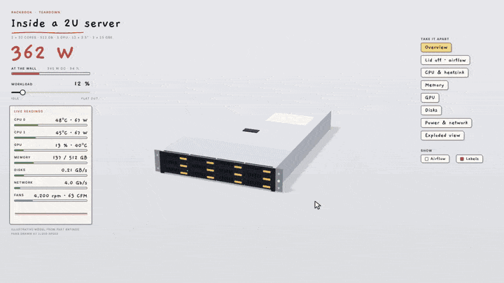
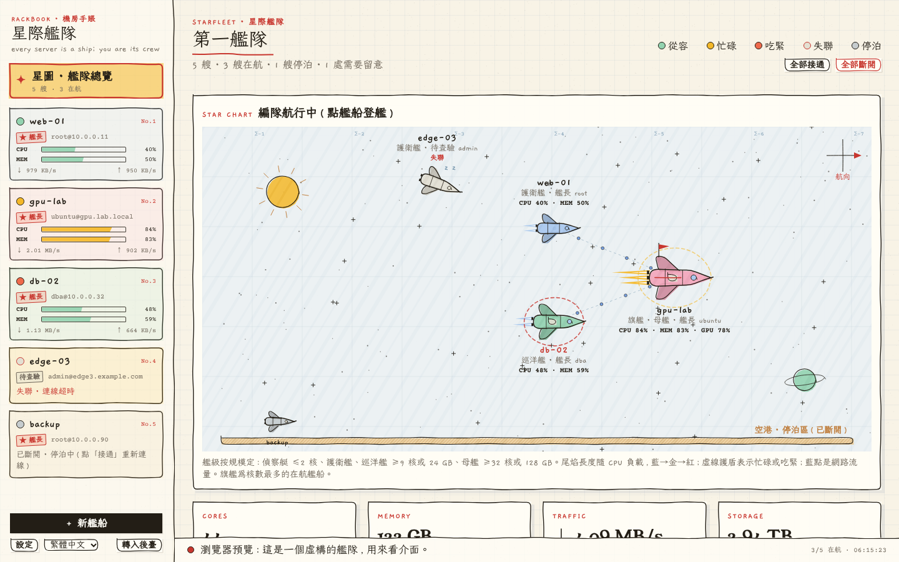
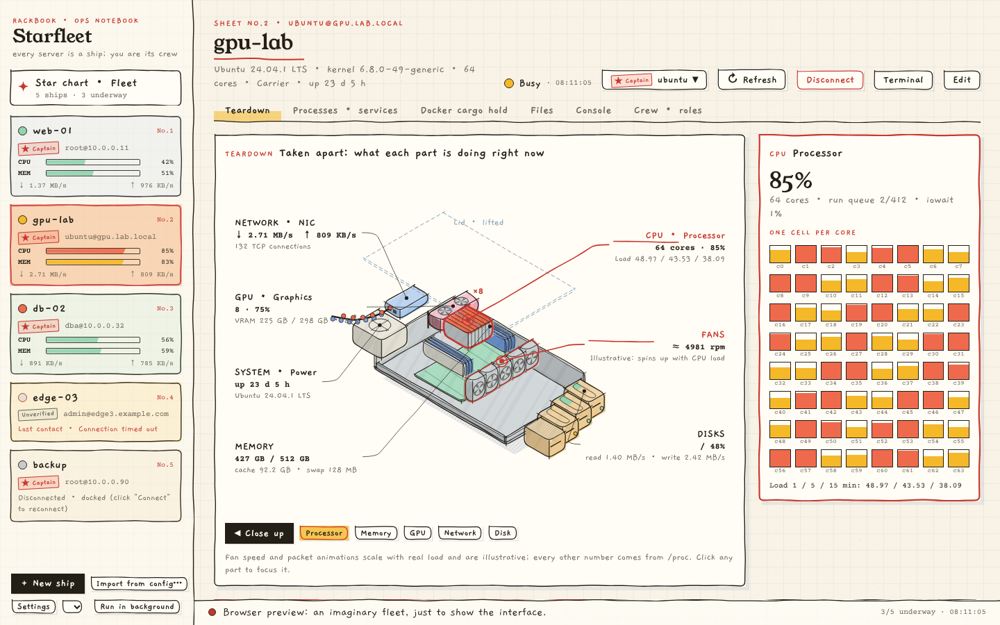
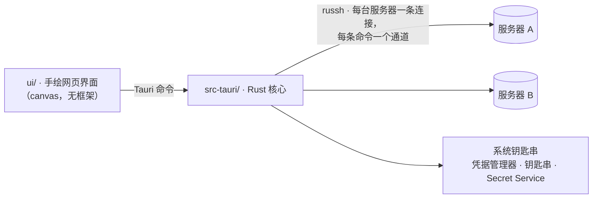

<p align="center">
  
</p>

<h1 align="center">Rackbook</h1>

<p align="center"><b>給伺服器用的手繪控制室。</b><br>
用最普通的 SSH 監控和管理整支伺服器艦隊，介面是馬克筆和鉛筆畫出來的。<br>
Windows · macOS · Ubuntu。</p>

<p align="center">
  <a href="../../README.md"></a>
  <a href="README.ja.md"></a>
  <a href="README.es.md"></a>
  <a href="README.zh-CN.md"></a>
  <a href="README.zh-TW.md"></a>
  <a href="README.ko.md"></a>
</p>

<p align="center">
  <a href="https://github.com/CrianeZRX/rackbook/releases/latest"></a>
  <a href="https://github.com/CrianeZRX/rackbook/actions/workflows/build.yml"></a>
  
  <a href="../../LICENSE"></a>
</p>

<p align="center">
  
</p>

<p align="center">
  <a href="https://crianezrx.github.io/rackbook/teardown/"><b>▶ 親手拆一台伺服器</b></a>（互動式 3D）
  &nbsp;·&nbsp;
  <a href="https://crianezrx.github.io/rackbook/demo/"><b>▶ 在瀏覽器裡試用 Rackbook</b></a>（一支虛構艦隊）
  &nbsp;·&nbsp;
  <a href="../media/teardown.mp4">帶聲音的完整影片</a>
</p>

---

## 為什麼是 Rackbook

大多數伺服器面板都是一牆一模一樣的灰色曲線。Rackbook 把每台伺服器畫成星際艦隊裡的一艘艦船，也畫成一台可以拆開的機器，哪台在吃緊、為什麼吃緊，一眼就能看出來。

- **伺服器上什麼都不用裝。** Rackbook 只用 SSH，讀取 `/proc`。能 `ssh` 進去的機器就能看。
- **看到了就能動手。** 程序、服務、Docker 容器、檔案和配置都在同一個視窗裡，重啟、停止、編輯、上傳都不用另開終端。
- **預設就安全。** 每個帳戶按 sudo 實際允許的許可權，分成「艦長」（有 sudo）或「領航員」（只能檢視、只能管自己的程序）。密碼只存在系統鑰匙串裡。
- **不打擾你。** 關掉視窗後它在托盤裡繼續值班；可選的懸浮窗只在你做別的事時出現。

## 功能一覽

<table>
<tr>
<td width="50%"><br><b>星圖。</b>每台伺服器是一艘艦船：大小代表艦級（核數和記憶體），尾焰代表 CPU 負載，虛線護盾表示需要留意，藍點是網路流量。停在港口的是已斷開的艦船。</td>
<td width="50%"><br><b>拆解圖。</b>等距視角的機器拆解：CPU 每個核一格，還有記憶體、GPU、網路、硬碟、風扇。點任意部件看它的歷史曲線。</td>
</tr>
<tr>
<td><br><b>Docker 貨艙。</b>容器的 CPU、記憶體、網路實時顯示，可以啟動、停止、重啟、看日誌、管理映象。帳戶不在 <code>docker</code> 組時自動改用 sudo。</td>
<td><br><b>視覺化編輯器。</b>支援 YAML、JSON、shell 配置、INI 和純文字：語法著色、可點選的結構大綱、伺服器端語法校驗，儲存前檢查衝突並自動備份。</td>
</tr>
<tr>
<td><br><b>程序與服務。</b>排序、篩選、給程序發訊號，啟動、停止、重啟 systemd 服務。</td>
<td><br><b>船員與角色。</b>切換登艦帳戶，檢視伺服器上的所有使用者，艦長可以任免船員。</td>
</tr>
</table>

<p align="center">
  <br>
  <sub>懸浮窗：隨意拖動，雙擊艦船登艦，右鍵開啟選項。顯示哪些指標、哪些艦船都由你決定。</sub>
</p>

### 六種語言，同一種筆跡

English · 日本語 · Español · 简体中文 · 繁體中文 · 한국어。在側欄或設定裡切換，托盤選單跟著變。每種文字都配了風格一致的手寫字型（Gaegu、Yomogi、站酷快乐体、霞鶩文楷 TC），全部內建在應用裡，離線也能用。你自己的伺服器名、路徑和命令輸出永遠不會被翻譯。

<p align="center"></p>

## 下載

在 **[Releases](https://github.com/CrianeZRX/rackbook/releases/latest)** 下載對應系統的安裝包：

| 系統 | 檔案 |
|---|---|
| Windows 10 / 11（x64） | `Rackbook_<版本>_x64-setup.exe` 或 `.msi` |
| macOS 10.15+（Intel 與 Apple 晶片） | `Rackbook_<版本>_universal.dmg` |
| Ubuntu 22.04+（x64） | `rackbook_<版本>_amd64.deb` 或 `.AppImage` |

> **macOS：** 應用還沒有經過公證。如果提示“已損壞”或“無法開啟”，執行一次
> `xattr -cr /Applications/Rackbook.app`，或者右鍵應用選「開啟」。
>
> **Ubuntu：** `sudo apt install ./rackbook_*.deb`。密碼儲存在 GNOME 鑰匙圈或 KWallet。

## 快速開始

1. 點「＋ 新艦船」，填寫主機、連接埠和使用者名稱。也可以點「從設定匯入…」，從 `~/.ssh/config`（Windows 上還有 PuTTY 工作階段）裡一次勾選匯入。
2. 選擇「金鑰」（路徑留空時會自動嘗試 `~/.ssh` 裡的常用金鑰）或「密碼」。
3. Rackbook 會檢查 `sudo` 實際允許什麼，把帳戶定為「艦長」或「領航員」。艦長可以儲存 sudo 密碼，之後操作不用每次都輸入。
4. 點選艦船登艦，開啟它的拆解圖、程序、Docker、檔案、控制檯和船員。

第一次連線時會信任並記住主機的 SSH 指紋（TOFU）。之後如果指紋變了，Rackbook 會拒絕連線。

## 工作原理



- 一個採集指令碼讀取 `/proc`、`df`、`ip`，以及（如果有的話）`nvidia-smi` 或 amdgpu sysfs 和 `docker stats`，每隔幾秒在已有連線上執行一次。
- 每條命令都開自己的通道，慢吞吞的 `docker logs` 不會卡住儀表。
- 上傳下載透過 `cat` 和 `tar` 流式傳輸，不需要配置 SFTP。

## 從原始碼構建

需要 [Rust](https://rustup.rs)（stable）和 Node.js 20+。

```bash
npm install
npx tauri dev       # 运行
npx tauri build     # 为当前系统生成安装包
```

- **Ubuntu：** `sudo apt install libwebkit2gtk-4.1-dev libayatana-appindicator3-dev librsvg2-dev libdbus-1-dev patchelf`
- **macOS 通用包：** `rustup target add aarch64-apple-darwin x86_64-apple-darwin && npx tauri build --target universal-apple-darwin`
- **只看介面：** 用任意靜態伺服器開啟 `ui/`（如 `python3 -m http.server`）裡的 `index.html`。沒有 Rust 核心時，它會使用內建的虛構艦隊。

推送 `v*` 標籤後，GitHub Actions 會在三個平台上構建，並把安裝包附到 Release 上。

## 拆解影片

開場影片和[互動式 3D 頁面](https://crianezrx.github.io/rackbook/teardown/)都由 [`showcase/`](../../showcase/) 裡的程式碼生成，使用 [teardown](https://github.com/elvarofficial/teardown) 工具包。機器是一台按真實零件尺寸建模的 2U 雙路 12 盤位伺服器。只有一個輸入——負載——驅動所有東西：CPU 和 GPU 功耗、保持進出風溫差 20 °F 所需的風扇轉速（CFM = 3.16 × W / ΔT）、帶熱慣性的散熱器溫度、經 94 % 電源後的牆插功率、磁碟和網路流量，還有指示燈。功耗和溫度是按零件額定值建立的示意模型，不是某台機器的實測資料。

## 目錄結構

```
src-tauri/            Rust 核心：SSH、采集、钥匙串、托盘与窗口
ui/                   应用前端：原生 JS + canvas 手绘绘图库，无需构建
  js/i18n.js          运行时翻译（词典在 js/i18n-dict.js）
  fonts/              内置手写字体（SIL OFL）
showcase/             3D 拆解影片和页面（three.js）
docs/                 截图、媒体和各语言 README
legacy/macos-swiftui/ 最早的原生 SwiftUI macOS 版（1.x），留作参考
```

## 參與貢獻

歡迎提 Issue 和 Pull Request，尤其歡迎翻譯：所有文案都在 `ui/js/i18n-dict.js` 裡，格式是 `"简体中文原文": [en, ja, es, ko, zh-TW]`。

## 許可

[MIT](../../LICENSE)。內建字型採用 SIL Open Font License 1.1（見 [ui/fonts/FONTS-LICENSE.md](../../ui/fonts/FONTS-LICENSE.md)）。展示部分使用了 MIT 許可的 [teardown](https://github.com/elvarofficial/teardown) 工具包和 [three.js](https://threejs.org)。
